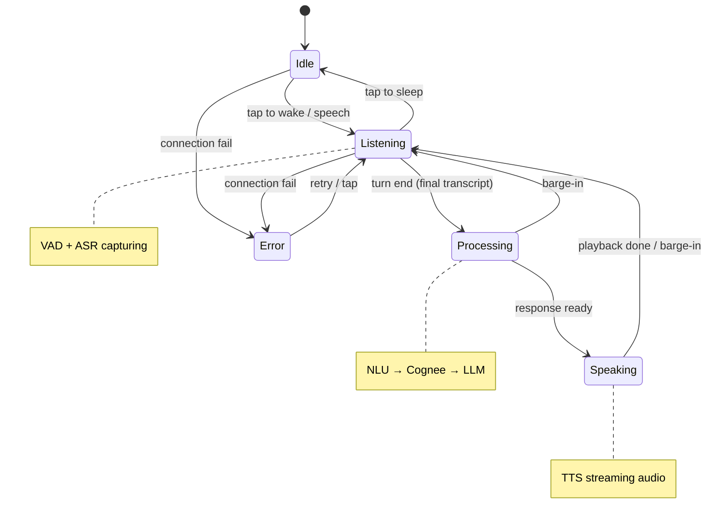

# Dialog Flow

The conversation as a state machine — the same states the orb animates through (idle / listening / processing / speaking). A turn cycles Listening → Processing → Speaking → Listening; barge-in and errors cut sideways.

### States

*   **Idle:** asleep, waiting. Tap (or speech) wakes it.
*   **Listening:** VAD + ASR capturing the user's speech. Ends the turn on the final transcript.
*   **Processing:** NLU → Cognee → LLM — intent, per-tenant retrieval, response generation.
*   **Speaking:** TTS streaming audio back. Returns to Listening when playback finishes.
*   **Error:** connection failed; tap retries.

### Transitions

*   **Barge-in:** user speaks during Processing or Speaking → cancel and drop straight back to Listening.
*   **Sleep:** tap while Listening → back to Idle.
