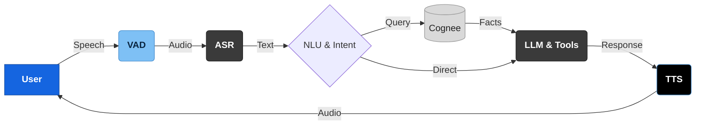

# Overall Structure

Noa voice pipeline, modeled on the layered voice-AI agent architecture: a horizontal speech spine (VAD → ASR → NLU → LLM → TTS) with a Dialogue Manager holding state, Cognee as the knowledge base, and observability spanning the stack.



### Layers

1.  **User:** speaks → **Audio Input** captures the stream.
2.  **VAD** (Voice Activity Detection): detects speech start/end, gates the pipeline.
3.  **ASR** (Automatic Speech Recognition): speech → text (compute-heavy).
4.  **NLU & Intent** (Natural Language Understanding): classifies intent, routes the turn.
5.  **LLM & Tools** (Large Language Model): reasoning + response generation (compute-heavy).
6.  **TTS** (Text-to-Speech): text → speech, streamed back.

### Cross-cutting

*   **Dialogue Manager** holds session **State & Context**; fed by VAD (turn signals), ASR (transcripts), and the **Cognee Knowledge Base** (per-tenant facts).
*   **Observability & Monitoring** taps the Dialogue Manager, LLM, and TTS for latency/error metrics.
```
